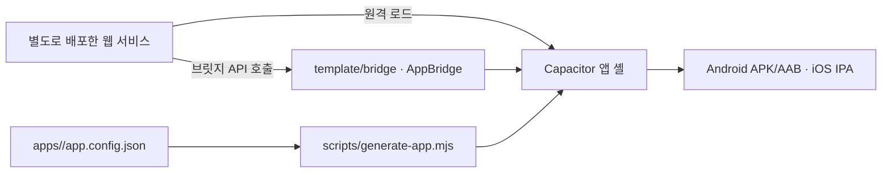

# app-harness-hpark

**배포된 웹 프로젝트를 iOS·Android 웹뷰 앱으로 빠르게 감싸기 위한 개인용 하네스입니다.** 새 프로젝트마다 앱 설정을 만들고 웹에 공유 브릿지를 연결하면, 같은 Capacitor 셸과 빌드 도구를 다시 사용할 수 있습니다. 이 저장소에는 웹 서비스의 화면이나 백엔드가 들어 있지 않습니다. 앱은 설정된 웹 주소를 실행 중에 불러옵니다.

이 코드는 [AIPIA의 app-harness](https://github.com/aipia-team/app-harness)를 기반으로 만든 공개 사본입니다. 기존 `apps/`의 설정과 `scripts/lib/config.mjs`의 기본값에는 AIPIA의 앱 ID, 도메인, 인증·분석·스토어 구성이 남아 있습니다. **새 프로젝트에 그대로 배포하지 말고 자신의 서비스에 맞게 바꾸세요.** 이 사본의 Git 이력은 공개를 위해 재작성되었으므로 커밋 해시와 작성자 정보가 원본의 기여 이력을 나타내지는 않습니다.

## 어떻게 동작하나요?



- **앱 설정**: `apps/<slug>/app.config.json`에 앱 이름, 앱 ID, 시작 URL(`startUrl`), 허용 도메인, 기능 등을 정의합니다. 생성기는 이 설정으로 `build/<slug>/`에 네이티브 프로젝트를 만듭니다.
- **웹 서비스**: 별도 저장소에서 개발·배포합니다. 앱 셸은 배포된 웹을 원격으로 불러오므로 일반적인 화면 변경은 웹 배포로 반영할 수 있습니다. 네이티브 코드나 앱 설정 변경에는 앱 재빌드가 필요합니다.
- **공유 브릿지**: `template/bridge/`의 `AppBridge`가 푸시, 딥링크, 공유, 인증, 인앱결제 등 필요한 네이티브 기능을 웹에 제공합니다. 기능 지원 여부는 앱 설정과 빌드에 따라 달라집니다.
- **빌드와 배포**: `scripts/`, `fastlane/`, `.github/workflows/`가 프로젝트 생성, 검사, 빌드, 내부 배포를 담당합니다. 스토어 계정·서명키·서비스 백엔드는 별도로 준비해야 합니다.

## 새 웹 프로젝트를 앱으로 만들기

### 1. 개발 환경 준비

Node.js 24(`.nvmrc`; 최소 22)를 사용합니다. Android 빌드에는 JDK 21과 Android SDK가, iOS 빌드에는 macOS와 Xcode가 필요합니다. 플랫폼별 상세 요구사항은 [설정 가이드](docs/05-SETUP.md)와 [기기 지원 표](docs/19-DEVICE-SUPPORT.md)를 참고하세요.

```bash
nvm use
npm ci
node scripts/doctor.mjs
npm test
```

`doctor.mjs`는 로컬 도구와 저장소 안의 앱 설정을 점검합니다. 기존 예시 앱에 관한 경고가 나오더라도 새 프로젝트의 설정을 별도로 확인하세요.

### 2. 앱 설정 만들기

`apps/<slug>/app.config.json`을 만듭니다. 기존 `apps/`의 파일은 형식을 살펴보는 예시로만 사용하고, 필드 정의는 [GUIDE의 설정 스키마](docs/02-GUIDE.md)를 따르세요. 적어도 다음을 새 프로젝트에 맞게 점검해야 합니다.

| 항목 | 확인할 내용 |
|---|---|
| `slug`, `appName`, `appId` | 앱 식별자와 화면에 표시할 이름 |
| `startUrl`, `navigation` | 배포한 웹의 HTTPS 주소, 웹뷰 이동 및 앱 링크 호스트 |
| `auth`, `iap`, `features` | 서비스 백엔드 계약과 실제로 사용할 네이티브 기능 |
| `firebase`, `marketing`, `monitoring` | 새 프로젝트의 콘솔·SDK 구성 |
| `legal`, `permissions`, `assets` | 정책 URL, 권한 문구, 아이콘과 스플래시 |

새 앱을 계속 추가할 계획이라면 `scripts/lib/config.mjs`의 `AIPIA_DEFAULTS`와 `aipiaPreset()`도 검토하세요. 원본 조직에 맞춘 값을 개인 프로젝트의 기본값으로 사용하면 잘못된 번들 ID·도메인·외부 서비스 설정이 생성될 수 있습니다.

### 3. 웹에 브릿지 연결하기

웹 프로젝트에서 GitHub Packages의 `@ha3158987/harness-bridge`를 사용합니다. 패키지가 발행된 뒤 웹 프로젝트의 npm 설정에 `@ha3158987` 스코프의 레지스트리를 지정하고 설치하세요. **공개 패키지 설치에도 GitHub 인증이 필요합니다.** 로컬 설치에는 `read:packages` 권한이 있는 GitHub classic PAT를 `GITHUB_PACKAGES_TOKEN` 환경변수로 주입하고, 토큰 값을 저장소에 기록하지 마세요.

```ini
@ha3158987:registry=https://npm.pkg.github.com
//npm.pkg.github.com/:_authToken=${GITHUB_PACKAGES_TOKEN}
```

```bash
npm install @ha3158987/harness-bridge@beta @capacitor/core
```

`@beta`는 현재 소스의 `1.5.0-beta.6`을 설치합니다. 원본 패키지와 같은 기본 안정판 `1.4.0`은 태그 없이 설치할 수 있습니다.

```js
import { AppBridge } from '@ha3158987/harness-bridge';

await AppBridge.ready();
if (AppBridge.isNative) {
  // 앱에서만 필요한 흐름을 연결합니다.
}
```

위 명령은 브릿지와 Capacitor 코어만 설치합니다. 브릿지가 동적으로 불러오는 Capacitor 플러그인의 **JS 패키지도 웹 프로젝트에 설치**해야 합니다. 사용 기능별 목록과 브라우저 폴백, 어댑터 패턴은 [웹 통합 가이드](docs/06-INTEGRATION.md)를 보세요. 원본 문서의 `@harness/bridge` 예시는 이 사본의 패키지명 `@ha3158987/harness-bridge`로 바꿔 읽어야 합니다. 이 저장소의 앱 셸은 `template/bridge/`를 로컬 의존성으로 설치하며, 별도 웹 프로젝트는 발행된 패키지를 사용합니다.

### 4. 앱 생성 및 디버그 빌드

설정에 사용한 슬러그로 프로젝트를 생성합니다. 생성된 `build/<slug>/`는 빌드 산출물입니다.

```bash
node scripts/generate-app.mjs --slug <slug> --platform android
cd build/<slug>/android
./gradlew assembleDebug
```

Android APK의 위치, iOS 빌드·서명 및 내부 테스트 배포 절차는 [배포 가이드](docs/07-HOWTO-DEPLOY.md)를 따르세요. 인증·결제·푸시처럼 외부 서비스가 필요한 기능은 해당 콘솔, 백엔드, 키 파일을 준비해야 실제로 동작합니다.

## 저장소 둘러보기

| 위치 | 역할 |
|---|---|
| `apps/<slug>/` | 앱별 설정과 이미지 자산; 기존 파일은 AIPIA 예시 |
| `template/bridge/` | 웹용 JS SDK와 Android·iOS 네이티브 플러그인 |
| `template/integration/` | 웹 서비스에 적용할 어댑터 예시 |
| `template/src/` | 로딩·오프라인 상황의 셸 화면 |
| `scripts/` | 설정 검사와 Capacitor 프로젝트 생성 |
| `fastlane/`, `.github/workflows/` | 서명·빌드·내부 배포 자동화 |
| `lab/` | 에뮬레이터·시뮬레이터 화면 테스트 도구와 시나리오 |
| `docs/` | 설정 스키마, 기능 통합, 배포 절차와 원본 설계 기록 |

## 사용 전 확인

- 이 저장소에 있는 AIPIA 앱 설정은 새 계정의 앱·도메인·스토어 등록을 대신하지 않습니다. 새 프로젝트의 번들 ID, 인증 콜백, 앱 링크, Firebase, IAP 상품과 정책 URL을 각각 확인하세요.
- 비밀번호, 토큰, 서명키 및 서비스 계정 파일은 Git에 커밋하지 마세요. 로컬 환경변수·별도 파일 또는 저장소 시크릿으로 관리합니다.
- 앱 셸은 웹을 보여주고 네이티브 기능을 연결합니다. 로그인 판정, 세션, 영수증 검증, 사용자 데이터는 해당 서비스의 백엔드 책임입니다.
- TestFlight·Play 내부 테스트와 프로덕션 공개는 별개입니다. 스토어 공개 전에는 각 플랫폼의 콘솔 설정과 심사를 확인하세요.

## 더 읽기

- [ONBOARDING.md](ONBOARDING.md) — 새 서비스 추가 순서
- [GUIDE](docs/02-GUIDE.md) — 전체 구조와 `app.config.json` 스키마
- [INTEGRATION](docs/06-INTEGRATION.md) — 웹 브릿지 API와 어댑터
- [APP-FEATURES](docs/18-APP-FEATURES.md) — 지원 기능과 패키지
- [HOWTO-DEPLOY](docs/07-HOWTO-DEPLOY.md) — 빌드·테스터 배포
- [AUTH-DELEGATION](docs/25-AUTH-DELEGATION.md) — 인증 계약과 브릿지 패키지 버전
