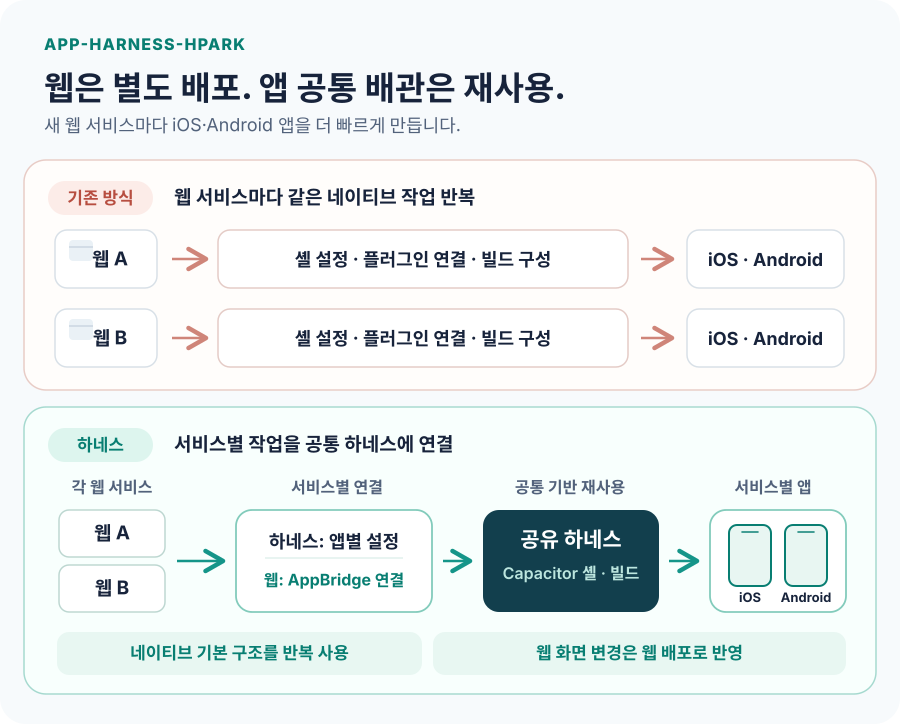

# app-harness-hpark

**새 웹 프로젝트를 iOS·Android 웹뷰 앱으로 빠르게 감싸기 위한 재사용 가능한 하네스.**

웹은 기존 저장소에서 개발·배포합니다. 이 하네스는 앱별 설정으로 Capacitor 셸을 만들고, 배포된 웹을 앱 안에 불러옵니다. 푸시·딥링크·인앱결제 같은 기기 기능은 웹에 설치한 `@ha3158987/harness-bridge`로 연결합니다.



## 새 앱 만들기

1. [빈 설정 템플릿](apps/app.config.template.json)을 `apps/<slug>/app.config.json`으로 복사하고 앱 이름, `appId`, `startUrl`, 사용할 기능을 입력한 뒤 `apps/<slug>/icon.png`와 `splash.png`를 준비합니다. [설정 스키마](docs/02-GUIDE.md)
2. 웹 프로젝트에 [`@ha3158987/harness-bridge@beta`](https://github.com/ha3158987/app-harness-hpark/pkgs/npm/harness-bridge)를 설치하고 필요한 기능을 연결합니다. GitHub Packages 설치에는 `read:packages` 인증이 필요합니다. [웹 연동 가이드](docs/06-INTEGRATION.md)
3. 이 저장소에서 앱 프로젝트를 생성합니다.

```bash
npm ci
node scripts/generate-app.mjs --slug <slug> --platform android
```

생성된 `build/<slug>/`에서 Android 또는 iOS 앱을 빌드합니다. 플랫폼별 준비와 서명 절차는 [빌드·배포 가이드](docs/07-HOWTO-DEPLOY.md)를 따르세요.
