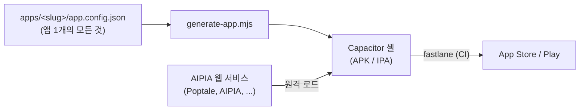

# Appharness — AIPIA Web→Native Harness (Capacitor)

> ⚠️ **범용 하네스가 아니라 AIPIA 전사 앱 하네스.** 식별자/도메인/스택/SDK 선택은
> [`AIPIA-CONVENTIONS.md`](AIPIA-CONVENTIONS.md) 의 전사 표준을 따른다.

AIPIA 의 여러 웹 서비스(Poptale, AIPIA, ...)를 **하나의 얇은 네이티브 셸 + 공유 브릿지**로 감싸
iOS/Android 앱으로 *반복 추출* 하는 하네스. 앱은 `server.url` 로 **배포된 웹을 원격 로드**하고,
웹은 `@harness/bridge` 로 네이티브 기능을 호출한다. 모든 작업은 **Claude Code 스킬**로 자동화.



---

## 시작 동선 (3가지 입장)

| 당신이 누구냐 | 어디부터 | 결과물 |
|---|---|---|
| **새 앱을 하네스에 추가하는 개발자** | [`AIPIA-CONVENTIONS.md`](AIPIA-CONVENTIONS.md) → [`ONBOARDING.md`](ONBOARDING.md) | `apps/<slug>/app.config.json` + 디버그 APK |
| **Poptale 이전을 맡은 담당자** | [`POPTALE-MIGRATION.md`](POPTALE-MIGRATION.md) ⭐ | 10주 일정 + 호환성 매트릭스 + 플러그인 SPEC |
| **하네스 자체를 손보는 사람** | [`GUIDE.md`](GUIDE.md) → [`STRATEGY.md`](STRATEGY.md) | 스키마/스킬/CI 변경 |

---

## 새 앱 1줄 부트스트랩

```js
import { aipiaPreset } from './scripts/lib/config.mjs';
import { writeFileSync, mkdirSync } from 'node:fs';

// 슬러그 하나만 정하면 90% 완성된 config 생성
const cfg = aipiaPreset({ slug: 'newservice', appName: 'New Service' });
mkdirSync('apps/newservice', { recursive: true });
writeFileSync('apps/newservice/app.config.json', JSON.stringify(cfg, null, 2));
```

자동 도출되는 값: 번들 ID(`com.aipia.newservice`), Firebase 프로젝트 3개
(`dev-aipia-newservice` / `stage-aipia-newservice` / `aipia-newservice`), 도메인
(`https://newservice.ai`), K-market 4 socials, Adbrix+Amplitude, Crashlytics+WhaTap,
다크모드, AppChannel 호환 등 — 전부 [`AIPIA-CONVENTIONS.md`](AIPIA-CONVENTIONS.md) 표준.

남은 작업: 서비스별 IAP 상품 등록, 푸시 화이트리스트, 아이콘/스플래시.

---

## 지원 기능 (요약)

- **앱 기능**: 푸시 · 딥링크 · 강제업데이트 · 카메라 · 생체인증 · 시큐어스토리지 · 로컬알림 · 햅틱 · 클립보드 · 위치 · 공유 · 안전영역 · 다크모드 · **화면캡쳐 방지**(경로별) · **뷰어 밝기**
- **인증/SSO**: AIPIA K-market 4(apple/google/kakao/naver, JWT 전체 전달) + 글로벌 확장(facebook/x/threads) · 중앙 IdP(Keycloak) · 회원가입 온보딩 · 게스트→실계정 병합 · 회원탈퇴 · 생체 빠른 로그인
- **결제**: 인앱결제(디지털 재화) · 웹앱 가격 분기 · **Google purchase token 압축**(Poptale 노하우) · 서버 지갑
- **마케팅/분석**: Adbrix(어트리뷰션) · Amplitude(분석) — AIPIA 표준. (AppsFlyer 슬롯 유지)
- **모니터링**: Firebase Crashlytics(크래시) · WhaTap(APM) — AIPIA 표준
- **호환성**: 기존 웹의 `window.AppChannel.postMessage("<scheme>://...")` 패턴 **무수정** 동작 — `installAppChannelShim()`
- **운영**: 권한 고지 · 개인정보/성인인증 · CI 자동배포 · 푸시 경로 화이트리스트(보안)

원칙: **하네스=네이티브 배관, 웹=`if(isNative) AppBridge.xxx()` 연결, 백엔드=검증/게이팅, 콘솔=신고.**

---

## 빠른 시작 (수동 흐름)

```bash
node scripts/doctor.mjs                                   # 환경 + 모든 앱 config 점검
node scripts/generate-app.mjs --slug <slug> --platform android
cd build/<slug>/android && ./gradlew assembleDebug        # 서명 없는 디버그 APK
```

- 새 서비스 추가 흐름 → [`ONBOARDING.md`](ONBOARDING.md)
- 웹에 기능 연결 → [`INTEGRATION.md`](INTEGRATION.md)
- config 스키마(정본) → [`GUIDE.md`](GUIDE.md) §6
- 인계 문서(Poptale) → [`POPTALE-MIGRATION.md`](POPTALE-MIGRATION.md)

---

## 레포 레이아웃

```
Appharness/
├── AIPIA-CONVENTIONS.md         ⭐ 전사 컨벤션 정본 (번들ID·도메인·SDK·이벤트명)
├── POPTALE-MIGRATION.md         ⭐ Poptale Flutter → 하네스 이전 인계 문서
├── GUIDE.md / ONBOARDING.md / INTEGRATION.md / AUTH.md / IAP.md / ...
├── apps/<slug>/app.config.json  # 앱 정의(단일 진실 공급원) + icon.png/splash.png
│   ├── aipia/                   #   AIPIA 본 앱 레퍼런스
│   ├── poptale/                 #   Poptale prod (com.aipia.poptale)
│   └── poptale-dev/             #   Poptale dev  (com.aipia.poptale.dev)
├── template/
│   ├── src/                     # 오프라인/에러 폴백 셸
│   ├── bridge/                  # 공유 브릿지 (Capacitor 플러그인 + JS SDK + 타입)
│   ├── integration/             #   harness-adapter.js (AppChannel shim 포함)
│   └── plugins/                 # 네이티브 플러그인 작업 사양서 (코드 아님)
│       ├── kakao/SPEC.md        #   P0
│       ├── naver/SPEC.md        #   P0
│       ├── adbrix/SPEC.md       #   P0
│       └── whatap/SPEC.md       #   P1/보류
├── build/<slug>/                # 생성된 Capacitor 프로젝트 (gitignore)
├── scripts/                     # generate-app.mjs, doctor.mjs
│   └── lib/config.mjs           #   스키마 + AIPIA_DEFAULTS + aipiaPreset()
├── backend/auth-reference/      # 인증+IAP 백엔드 레퍼런스 (Node, in-memory)
├── idp/                         # 중앙 IdP(Keycloak) 로컬 구동 세트
├── fastlane/                    # 빌드/업로드 lane
├── .github/workflows/release.yml # CI 자동배포
└── .claude/skills/              # 자동화 스킬(new-app, integrate-web, build-*, ...)
```

---

## 📚 문서 색인

| 문서 | 내용 |
|---|---|
| **[`AIPIA-CONVENTIONS.md`](AIPIA-CONVENTIONS.md)** ⭐ | **AIPIA 전사 컨벤션 정본.** 번들ID·Firebase·도메인·소셜·결제·트래킹·모니터링·이벤트명·최소OS — 새 앱 추가 전 필독 |
| **[`GUIDE.md`](GUIDE.md)** | 하네스 사용법 마스터 — 지원 기능·흐름·필수 입력·스키마 정본·문서 색인 |
| **[`POPTALE-MIGRATION.md`](POPTALE-MIGRATION.md)** ⭐ | **Poptale Flutter → 하네스 이전** 인계 문서(호환성 매트릭스 10개·10주 일정·책임 분담·플러그인 SPEC 색인) |
| [`ONBOARDING.md`](ONBOARDING.md) | 새 서비스 추가 전체 흐름 |
| [`INTEGRATION.md`](INTEGRATION.md) | 프론트 통합 — `@harness/bridge` + 어댑터 + API + AppChannel shim |
| [`SETUP.md`](SETUP.md) | 환경/키 단계별 준비 |
| [`AUTH.md`](AUTH.md) | 로그인/SSO/회원가입/게스트/탈퇴/중앙 IdP/백엔드 규약 |
| [`IAP.md`](IAP.md) | 인앱결제/웹앱 가격분기/지갑/백엔드 검증/Google 토큰 압축 |
| [`COMPLIANCE.md`](COMPLIANCE.md) | 접근권한/개인정보/성인인증/연령등급 |
| [`DATA-COLLECTION.md`](DATA-COLLECTION.md) | 스토어 개인정보 양식·처리방침용 수집 목록 |
| [`DEPLOY.md`](DEPLOY.md) | CI/CD 자동배포/시크릿/서명 |
| [`DEVICE-SUPPORT.md`](DEVICE-SUPPORT.md) | 기기/OS/해상도/노치/폴더블 |
| [`MARKETING.md`](MARKETING.md) | 마케팅 SDK (AppsFlyer / Adbrix / Amplitude) |
| [`template/plugins/`](template/plugins/) | 네이티브 플러그인 작업 사양서 (Kakao/Naver/Adbrix/WhaTap) |
| [`STRATEGY.md`](STRATEGY.md) · [`REFERENCES.md`](REFERENCES.md) · [`APP-FEATURES.md`](APP-FEATURES.md) | 전략 · 외부참조 · 기능·플러그인 |
| [`idp/README.md`](idp/README.md) · [`backend/auth-reference/`](backend/auth-reference/) | Keycloak 구동 · 백엔드 레퍼런스 |

---

## 환경 / 요구사항

| 항목 | 값 |
|---|---|
| Capacitor | 8 |
| Node | 20 LTS+ (AIPIA 표준: 20.18.3) |
| pnpm (웹 측) | 10.5.2 (AIPIA 웹 표준) |
| JDK (Android) | **21 필수** |
| Android SDK | platform 35, build-tools 35 (target 36 — AIPIA 표준 🅰️) |
| Android 최소 OS | **API 29 (Android 10)** 🅰️ |
| iOS 최소 | **15.0** 🅰️ |
| iOS 빌드 | macOS + Xcode 26 (또는 CI macOS 러너) |

점검 명령: `node scripts/doctor.mjs`

---

## 현재 상태 (정직)

### 검증됨 ✅
- Android `assembleDebug` 빌드 (전 기능 + 8 소셜 + IAP + 안전영역)
- 백엔드 레퍼런스 스모크(게스트/기기/지갑)
- `aipiaPreset()` 자동 생성 → loadConfig 검증 통과
- 3개 앱 config (`aipia`, `poptale`, `poptale-dev`) doctor 통과, 오류 0

### 미검증 ⚠️
- **iOS 빌드** (Windows 환경에서 작성) — 첫 macOS/CI 실행에서 엔타이틀먼트 pbxproj 연결 확인 필요
- Kakao/Naver/Adbrix/WhaTap 네이티브 플러그인 — `template/plugins/*/SPEC.md` 작업 사양만 있음, 실제 SDK 통합은 dev 가 채워야 함
- Poptale 마이그 호환성 매트릭스(`POPTALE-MIGRATION.md §3`) — 10개 항목 PASS/FAIL 검증 미실행

### 외부 의존(사람 몫) 🙋
- Apple Developer Program / Google Play Console 계정 · 멤버십
- Apple/Google/Kakao/Naver Developer Console 의 앱 등록 + 키 해시
- 스토어 IAP 상품 · 가격 티어 · 개인정보 라벨
- Firebase 프로젝트 3개(`{env}-aipia-<slug>`) 생성 + google-services 파일
- Adbrix/Amplitude/WhaTap 대시보드 앱 등록
- IdP 배포(Keycloak) — 중앙 SSO 사용 시

자세히: [`AIPIA-CONVENTIONS.md §14·§15`](AIPIA-CONVENTIONS.md), [`GUIDE.md §5`](GUIDE.md).

---

## 안전 원칙 (변하지 않는 것들)

- **시크릿/키 절대 config·레포 금지** — GitHub Secrets / fastlane match / 환경변수만
- **프로덕션 스토어 공개는 사람이 승인** — 자동화는 베타/내부 트랙까지
- **빅뱅 금지** — 동작하는 앱(Poptale Flutter)은 패리티 검증 전까지 깨지 않는다
- **자격증명/결제정보 자동 입력 금지**
- **회원탈퇴 엔드포인트 필수** — 스토어 정책

---

## 라이센스 / 컨택

- 사내 비공개 레포(aipia-team org)
- 컨벤션/하네스 관련 문의: AIPIA 팀 내부 채널
- Poptale 이전 인계: [`POPTALE-MIGRATION.md §2`](POPTALE-MIGRATION.md) 책임 분담 표 참조
