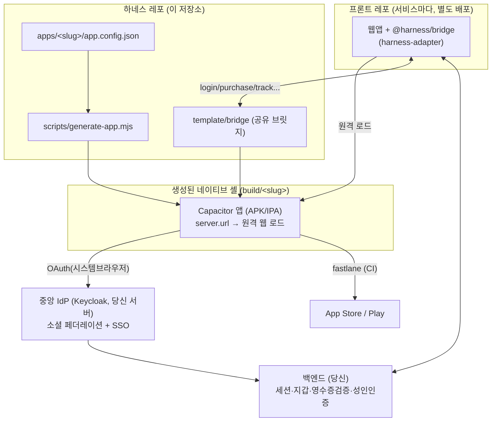
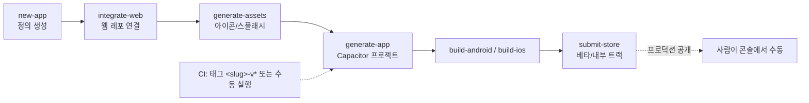
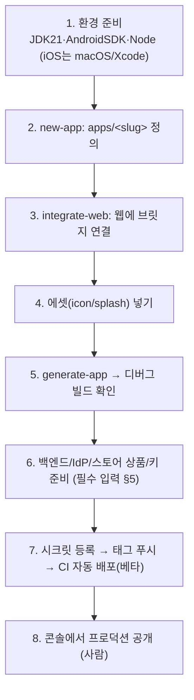

# GUIDE — Appharness 마스터 가이드

> 이 문서 하나로 **무엇이 지원되는지 · 무엇을 읽어야 하는지 · 무엇을 직접 해야 하는지(필수 입력)** 를 파악한다.
> 서식: Markdown + Mermaid(다이어그램) + 최소한의 HTML(표/접기). AI가 읽고 사람이 시각화하기 위한 공통 서식만 사용.
>
> 📌 이 하네스는 AIPIA 전사 앱 하네스 — 식별자/도메인/스택/SDK 표준은 [`01-AIPIA-CONVENTIONS.md`](./01-AIPIA-CONVENTIONS.md).
> 이 GUIDE 는 *하네스 동작 방식*, AIPIA-CONVENTIONS 는 *전사 합의값*. 둘은 보완관계.

---

## 0. 한 줄 정의
여러 **웹 서비스**를 하나의 얇은 **Capacitor 네이티브 셸 + 공유 브릿지**로 감싸 iOS/Android 앱으로 찍어내는 하네스.
앱은 `server.url` 로 **배포된 웹을 원격 로드**하고, 웹은 `@harness/bridge` 로 네이티브 기능을 호출한다. 모든 작업은 **Claude Code 스킬**로 자동화.

---

## 1. 아키텍처



**역할 분담(핵심 멘탈 모델)**

| 주체 | 책임 |
|---|---|
| **하네스** | 네이티브 배관 + `AppBridge.*` API + 빌드/배포 자동화 (스킬) |
| **웹(프론트)** | `@harness/bridge` import + `if(isNative) AppBridge.xxx()` 로 **연결** (기능당 1줄) |
| **백엔드** | 토큰/영수증 **검증**, 세션, 지갑, 성인인증 **게이팅** (서버 권위) |
| **콘솔(사람)** | 스토어 상품·개인정보 양식·연령등급, 소셜/서명 키 발급 |

> 반복 원칙: **클라는 흐름을 열고 컨텍스트만, 검증·게이팅·신고는 서버/콘솔.**

---

## 2. 자동화 흐름 (스킬 체인)



예) **"AIPIA 웹 레포 연결해서 양쪽 빌드하고 베타 올려줘"** → 위 체인을 AI가 엮어 실행(계정/키 준비 시).

**스킬 목록**

| 스킬 | 역할 |
|---|---|
| `new-app` | `apps/<slug>/app.config.json` 정의 생성 |
| `integrate-web` | 웹 레포에 브릿지/어댑터 배치 + call site 분기(웹 경로 보존) |
| `generate-assets` | 아이콘(1024²)/스플래시(2732²) 전 사이즈 생성 |
| `bump-version` | version.name/code 올림 |
| `build-android` | generate-app → gradle (AAB/APK), 헤드리스 |
| `build-ios` | generate-app → xcodebuild (.ipa), **macOS 필요** |
| `submit-store` | fastlane → TestFlight / Play 내부·베타 (프로덕션 제외) |

점검 도구: `node scripts/doctor.mjs` (환경 + 모든 앱 config 검사)

---

## 3. 지원 기능 전체

`AppBridge.ready()` 후 `AppBridge.capabilities` 로 피처 디텍션. 웹/브라우저에선 안전한 폴백.

<details><summary><b>브릿지 API 전체 (펼치기)</b></summary>

| 영역 | API | config 블록 | 문서 |
|---|---|---|---|
| 코어 | `ready` `isNative` `platform` `capabilities` `config` `context` | — | INTEGRATION |
| 로그인/SSO | `login` `logout` `completeSignup` `deleteAccount` `getLastLogin` `guestLogin` `onDeepLink` | `auth` | AUTH |
| 기기바인딩 | `enableBiometricLogin` `biometricLoginEnabled` `unlock` (+`registerPush`로 기기등록) | `auth.deviceEndpoint` | AUTH §3-7 |
| 인앱결제 | `getProducts` `purchase` `restorePurchases` | `iap` | IAP |
| 권한 | `getPermissionNotice` `requestPermission` `permissionStatus` | `permissions` | COMPLIANCE |
| 추적동의 | `requestTracking` (iOS ATT) | `marketing` | DATA-COLLECTION |
| 공유/링크 | `share` `openExternal` | `features.share` | INTEGRATION |
| 푸시/알림 | `registerPush` `scheduleNotification` `cancelNotification` | `features.push`/`localNotification` | APP-FEATURES |
| 강제업데이트 | `checkForceUpdate` (자동) | `features.forceUpdate` | §6 |
| 카메라/위치/햅틱/클립보드 | `takePhoto` `getLocation` `haptic` `copyToClipboard` `readClipboard` | `features.*` | APP-FEATURES |
| 저장 | `secureSet/Get/Remove`(민감) `setPref/getPref/removePref` | `features.secureStorage` | APP-FEATURES |
| 기기/네트워크/키보드/복귀 | `getDeviceInfo` `getNetworkStatus` `onNetworkChange` `onKeyboard` `onResume` | — | INTEGRATION |
| 안전영역 | `getSafeAreaInsets` | (자동) | DEVICE-SUPPORT §4b |
| 마케팅/분석 | `initMarketing` `track` `setUser` | `marketing` | MARKETING |
| 모니터링 | `initMonitoring`(자동) `reportError` | `monitoring` | INTEGRATION §4b |
| 백버튼 | `onBackButton` | — | APP-FEATURES |

</details>

**capabilities 플래그**: `push, deepLink, deferredDeepLink, biometric, share, camera, forceUpdate, secureStorage, localNotification, haptics, clipboard, geolocation, auth, iap`

**인증/계정 지원 범위**: 이메일 + 소셜 8(apple/google/naver/kakao/facebook/x/threads) · 중앙 IdP(SSO) · 회원가입 온보딩(약관/추가정보) · 게스트→실계정 병합 · 회원탈퇴 · 생체 빠른 로그인 · 기기 등록.

---

## 4. 빠른 시작



문서 시작점: **새 서비스 추가 = `../ONBOARDING.md`**, **프론트 통합 = `06-INTEGRATION.md`**.

---

## 5. 필수 입력 (사람이 준비해야 하는 것)

> 하네스 코드 외에 **반드시 외부에서 발급/구축**해야 동작하는 것들. 없으면 빌드는 돼도 기능이 비활성.

<details><summary><b>5-1. 계정 · 멤버십</b></summary>

- Apple Developer Program ($99/년) — iOS 배포 전제
- Google Play Console ($25 1회)
- 소셜 OAuth 앱(키): Google/Apple/Facebook/X/Threads + **Naver/Kakao**(한국)
- (성인 콘텐츠 시) 본인확인 PG 계약: NICE/PASS/KCB 등
</details>

<details><summary><b>5-2. 서명 · 시크릿 (GitHub Secrets — 08-DEPLOY.md §4)</b></summary>

| Secret | 용도 |
|---|---|
| `ANDROID_KEYSTORE_BASE64` / `_PASSWORD` / `ANDROID_KEY_ALIAS` / `_PASSWORD` | Android 릴리즈 서명 |
| `PLAY_SERVICE_ACCOUNT_JSON` | Play 업로드 |
| `MATCH_GIT_URL` / `MATCH_PASSWORD` / `MATCH_GIT_BASIC_AUTHORIZATION` | iOS 인증서(match) |
| `ASC_KEY_ID` / `ASC_ISSUER_ID` / `ASC_KEY_P8` | App Store Connect API |
| `APPSFLYER_DEV_KEY` / `APPSFLYER_IOS_APP_ID` | 마케팅(선택) |

원칙: **시크릿/키는 절대 config·레포에 두지 않는다.** 공개값(clientId, Sentry dsn)만 config.
</details>

<details><summary><b>5-3. 백엔드 엔드포인트 (레퍼런스: backend/auth-reference)</b></summary>

| 엔드포인트 | 역할 | 문서 |
|---|---|---|
| `POST /auth/native` | 소셜 자격증명 → 검증 → 세션 / 신규 온보딩 유도 | AUTH §3 |
| `POST /auth/signup` | 약관+추가정보 → 가입 확정 | AUTH §3-4 |
| `POST /auth/guest` | 게스트(익명) 계정 | AUTH §3-6 |
| `POST /auth/logout` `/auth/delete` | 로그아웃 / 회원탈퇴 | AUTH §3-5 |
| `POST /auth/device` | 푸시토큰·기기 등록 | AUTH §3-7 |
| `GET /auth/me` `GET /wallet` | 세션 확인 / 지갑 잔액 | — |
| `POST /iap/verify` | 영수증 검증 + 지갑 적립 | IAP §5 |
| `POST /webhooks/apple` `/webhooks/google` | 환불 회수 | IAP §5 |
| (성인) 본인확인 콜백 + 상태 | 성인 검증 저장/게이팅 | COMPLIANCE §3 |

중앙 IdP(Keycloak)는 `idp/` 로 자기 서버에 배포(소셜 한 곳 등록 → 패밀리 앱 공유).
</details>

<details><summary><b>5-4. 스토어 콘솔 (사람)</b></summary>

- IAP 상품 등록(Consumable, 가격 티어 = 앱 가격)
- 개인정보 라벨 / 데이터 안전성 양식 → `17-DATA-COLLECTION.md` 대로(AppsFlyer 광고ID+ATT 주의)
- 개인정보처리방침 URL(`legal.privacyUrl`), 연령 등급(Apple 17+/GRAC)
- iOS 딥링크/소셜 복귀: 엔타이틀먼트는 generate-app 이 pbxproj 연결(첫 macOS 빌드서 확인)
</details>

<details><summary><b>5-5. 에셋</b></summary>

- `apps/<slug>/icon.png` (1024×1024), `apps/<slug>/splash.png` (2732×2732)
- 없으면 디버그 빌드는 되지만 스토어 제출엔 필요
</details>

---

## 6. config 스키마 (단일 진실 공급원) — 정본

`apps/<slug>/app.config.json` **= 앱 1개의 모든 것**. 이 절이 스키마의 정본(블록별 상세는 각 문서).

```jsonc
{
  "slug": "aipia", "appName": "AIPIA", "appId": "kr.co.aipia.app",
  "startUrl": "https://aipia.co.kr",
  "version": { "name": "1.0.0", "code": 1 },
  "theme": { "primary": "#1A73E8", "statusBarStyle": "light", "background": "#FFFFFF" },
  "assets": { "icon": "icon.png", "splash": "splash.png" },
  "features": { "push": true, "deepLink": true, "biometric": true, "share": true,
    "camera": true, "forceUpdate": { "enabled": true, "minVersionUrl": "..." },
    "secureStorage": true, "localNotification": true, "haptics": true,
    "clipboard": true, "geolocation": true,
    "darkMode": true, "appChannelCompat": false,
    "pushPolicy": { "allowedPaths": null },
    "viewer": { "captureBlock": { "enabled": false, "paths": [] },
                "brightness": { "enabled": false } } },
  "navigation": { "allowedDomains": ["aipia.co.kr", "*.aipia.co.kr"], "externalInBrowser": true },
  "marketing": { "attribution": { "provider": "appsflyer", "deferredDeepLink": true } },
  "auth": { "providers": ["email","apple","google","naver","kakao","facebook","x","threads"],
    "idp": { "issuer": "https://auth.aipia.co.kr/realms/aipia", "clientId": "aipia-app",
      "hintParam": "kc_idp_hint", "hints": { "x": "twitter" } },
    "sessionEndpoint": "...", "signupEndpoint": "...", "logoutEndpoint": "...",
    "deleteEndpoint": "...", "guestEndpoint": "...", "deviceEndpoint": "..." },
  "iap": { "verifyEndpoint": "...", "googleTokenCompression": false, "products": [
    { "id": "coin_100", "storeId": "kr.co.aipia.app.coin100", "type": "consumable" } ] },
  "monitoring": { "crash": { "provider": "sentry", "dsn": "", "environment": "production" },
                  "apm": { "provider": null } },
  "firebase": { "enabled": false, "fcm": false, "analytics": false, "crashlytics": false,
                "remoteConfig": false, "project": { "dev": null, "stage": null, "prod": null } },
  "ios": { "teamId": null },                          // 조직 공통 — 보통 환경변수로 해결
  "android": { "sha256CertFingerprints": [] },        // 앱마다 다름 — Play 앱 서명 시 2개
  "legal": { "privacyUrl": "...", "termsUrl": "...", "ageVerifyUrl": "..." },
  "permissions": { "notifications": { "required": false, "purpose": "..." } }
}
```

**필드 메모**
- `features`: 전부 자동 배선 — 켜면 동작. 브릿지가 `ready()` 시 capability↔메서드 불일치를 콘솔 경고.
- `features.deferredDeepLink` 는 하위호환으로 `marketing.attribution` 으로 자동 매핑.
- `features.appChannelCompat`: 기존 웹에 `window.AppChannel.postMessage("scheme://...")` 패턴이
  박혀 있을 때 활성. `harness-adapter` 의 `installAppChannelShim({scheme})` 으로 폴리필.
- `features.pushPolicy.allowedPaths`: FCM data.link 의 경로 화이트리스트. null = 전허용,
  배열이면 prefix 매칭(예: `['/recommend','/detail/','/viewer']`).
- `features.viewer.captureBlock`: 지정 경로 prefix 에서만 화면 캡쳐 차단. SPA 라우팅 자동 감지는
  `harness-adapter.autoBlockCaptureOnPaths()` 로.
- `auth.idp` 있으면 중앙 IdP 모드(없으면 `auth.oauth.<provider>` 직접 모드). 둘 중 하나.
- `iap.googleTokenCompression`: Google purchase token 이 길어 페이로드 한계에 걸릴 때 gzip+base64.
  활성 시 `verifyEndpoint` 백엔드도 같은 포맷을 수용해야 함.
- `monitoring.apm`: APM/RUM 벤더 (`whatap` | `datadog` | null). 크래시와 별개.
- `firebase.enabled`: FCM/Analytics/Crashlytics/RemoteConfig 토글 + flavor 별 프로젝트 ID 표시.
  실제 google-services.json / GoogleService-Info.plist 는 secrets 에서 빌드 시 배치.
- `theme.statusBarStyle`: `light`(밝은 배경/어두운 텍스트) | `dark`. `version.code` 는 단조 증가 정수.

**config 를 바꾼 뒤 재생성하면 어디까지 반영되나**

`generate-app` 은 재실행 안전(idempotent)이지만, **네이티브 패치는 "없으면 추가" 방식**이라 이미
들어간 값은 고치지 않는다. 무엇이 갱신되고 무엇이 안 되는지 알고 써야 한다.

| 대상 | 재실행 시 |
|---|---|
| `www`, `app-config.json`, `capacitor.config.json`, 버전 코드 | ✅ 매번 덮어씀 |
| `package.json` 플러그인 목록 | ✅ **빠진 것 추가**(삭제는 안 함) |
| `Info.plist` 문구, associated-domains, Android intent-filter | ⚠️ 없으면 추가, **있으면 안 고침** |

즉 `tracking.att.usageDescription` 같은 **문구를 바꾸면 기존 build 에는 반영되지 않는다.**
확실히 하려면 `rm -rf build/<slug>` 후 재생성한다.

---

**딥링크 도메인 증명 파일 (`features.deepLink: true` 일 때 자동 생성)**

Universal Link(iOS) / App Link(Android) 는 **앱 설정만으로는 동작하지 않는다.** 도메인이 "이 앱을
신뢰한다"고 선언하는 파일 2개를 **웹이 서빙**해야 하고, 없으면 링크가 에러 없이 조용히 브라우저로 열린다.

generate-app 이 `build/<slug>/well-known/<host>/` 에 만들어 둔다 (네이티브 플랫폼 불필요 →
`--skip-install` 드라이 실행만으로도 받아갈 수 있다). 웹 레포로 옮기는 건 사람이 한다:

| 파일 | 웹 서빙 경로 | 주의 |
|---|---|---|
| `apple-app-site-association` | `<웹루트>/.well-known/apple-app-site-association` | **확장자 없음**, `Content-Type: application/json`, 리다이렉트 없이 200 |
| `assetlinks.json` | `<웹루트>/.well-known/assetlinks.json` | — |

둘 다 **인증 미들웨어에서 제외**해야 한다(Apple/Google 크롤러는 비로그인으로 받아간다).

필요한 입력값 2개:

| 값 | 어디에 | 앱별? | 얻는 곳 |
|---|---|---|---|
| Apple 팀 ID | `ios.teamId` (신규 앱은 프리셋이 자동으로 채움) · env `APPLE_TEAM_ID` / `FASTLANE_DEV_TEAM_ID` 로 덮기 가능 | **조직 공통 — 이미 채워져 있음** (`3W889GYPRK`) | Apple Developer > Membership details |
| SHA-256 지문 | `android.sha256CertFingerprints` | **앱마다 다름** | Play Console > 앱 > 설정 > 앱 서명 |

> ⚠️ **Play 앱 서명을 쓰면 지문이 2개다** — 업로드 키 + Play 가 관리하는 앱 서명 키. 업로드 키만
> 넣으면 App Link 검증이 조용히 실패한다. `adb shell pm get-app-links <package>` 로 확인할 것.
>
> ⚠️ **한 호스트를 여러 앱(dev/stage/prod)이 쓰면 파일 하나에 그 앱들이 전부 들어간다.** 하네스가
> `apps/*` 를 훑어 자동으로 합친다 — 앱별로 따로 올리면 나중 것이 앞선 것을 덮어 링크가 깨진다.

**강제 업데이트 — 최소버전을 어디서 읽나**

```
RC(source: 'remoteConfig')  →  URL(minVersionUrl)  →  통과
```

`source: 'remoteConfig'` 여도 **URL 은 폴백으로 남는다.** RC 는 캐시 지연·fetch 실패가 있고
게이트는 fail-open 이라, 폴백이 있으면 그 구멍이 좁아진다. 둘 다 못 읽으면 **막지 않는다** —
값을 못 읽었다고 사용자를 막으면 호스팅 장애가 곧 전체 앱 장애가 된다. 보안 패치를 강제해야 하면
클라이언트 게이트가 아니라 **서버가 구버전 요청을 거부**하는 방식이 맞다.

**Remote Config 키** (`source: 'remoteConfig'` 일 때 Firebase 콘솔에 만든다)

| 키 | 타입 | 예시 |
|---|---|---|
| `min_version_code_ios` / `min_version_code_android` | Number | `11` |
| `store_url_ios` / `store_url_android` | String | 스토어 URL (미설정 시 appId 로 조립) |
| `force_update_message` | String | 게이트 본문 |
| `force_update_hard` | Boolean | `false` 면 "나중에"로 닫히는 소프트 권유 |

> ⚠️ `min_version_code_*` 가 없거나 0 이면 RC 는 "의견 없음"으로 보고 **URL 폴백으로 넘어간다.**
>
> ⚠️ **캐시 지연.** `firebase.remoteConfigFetchIntervalSeconds`(기본 3600) 안에는 서버를 다시
> 찌르지 않는다. 콘솔에서 눌러도 최대 그만큼 늦다. 즉시 반영을 기대하지 말 것.

**`features.forceUpdate.minVersionUrl` 이 가리키는 JSON** (게이트가 읽음, 플랫폼별 우선·최상위 폴백):
```jsonc
{
  "ios":     { "minVersionCode": 5, "storeUrl": "https://apps.apple.com/app/idXXXX", "message": "업데이트 안내", "force": true },
  "android": { "minVersionCode": 7, "storeUrl": "https://play.google.com/store/apps/details?id=…" },
  "storeUrl": "…", "message": "…"
}
```
현재 `version.code` < `minVersionCode` 면 전체화면 게이트(`force:false` 면 "나중에"로 닫힘).

> ⚠️ **시크릿 금지**: client secret, 서명키, 스토어키, AppsFlyer devKey 는 config 에 두지 않는다(환경변수/Secrets).
> 공개값(clientId, Sentry dsn, 엔드포인트 URL)만 config. 빌드 시 AppsFlyer 키는 환경변수→네이티브 베이크(웹 폴백엔 미포함).

---

## 7. 환경

| 항목 | 값 |
|---|---|
| Capacitor | 8 |
| Node | 20 LTS+ |
| JDK (Android) | **21 필수** |
| Android SDK | platform 35, build-tools 35 (targetSdk 35, 2026-08 이후 36) |
| iOS | **macOS + Xcode 26** (또는 CI macOS 러너 — 맥 없이) |

점검: `node scripts/doctor.mjs`

---

## 8. 문서 색인 — "무엇을 볼까"

> 문서 색인은 **레포 루트 [`CLAUDE.md`](../CLAUDE.md) 하나로 통합**됐다.
> 목적별 라우팅 · 전체 22개 문서 · 카테고리 · 대상 독자 · 상태가 그 한 파일에 있다.
> (이 자리에 있던 mindmap 은 문서 4개가 누락된 채 낡아 있어 제거했다.)

config 스키마 상세는 이 문서 §6.

---

## 9. 현재 상태 / 주의 (정직)

- ✅ **검증됨**: Android `assembleDebug` 빌드(전 기능 + 8 소셜 + IAP + 안전영역 등), 백엔드 레퍼런스 스모크(게스트/기기/지갑).
- ⚠️ **미검증**: **iOS 빌드**(Windows 환경) — 첫 macOS/CI 실행에서 엔타이틀먼트 pbxproj 연결 확인 필요.
- ⚠️ **레퍼런스/스텁**: `backend/auth-reference`(인메모리), `/iap/verify` 검증 로직 → 실 DB·실 검증으로 교체.
- 🙋 **사람/외부**: 계정·서명·소셜키·스토어 상품·본인확인 PG·IdP 배포 (§5). 하네스는 흐름을 열고 받을 뿐.
